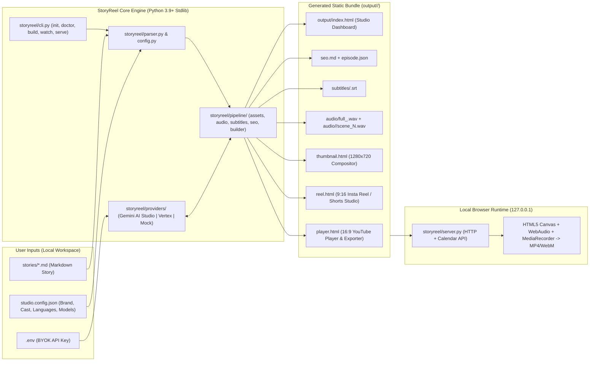
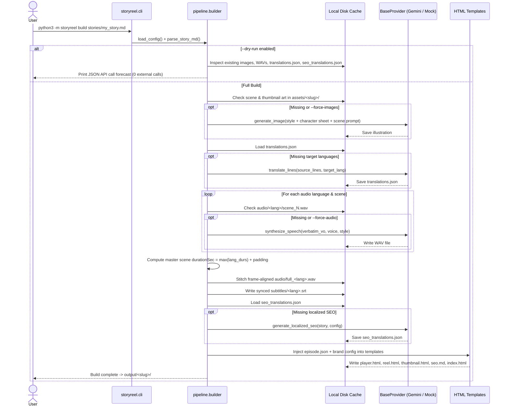
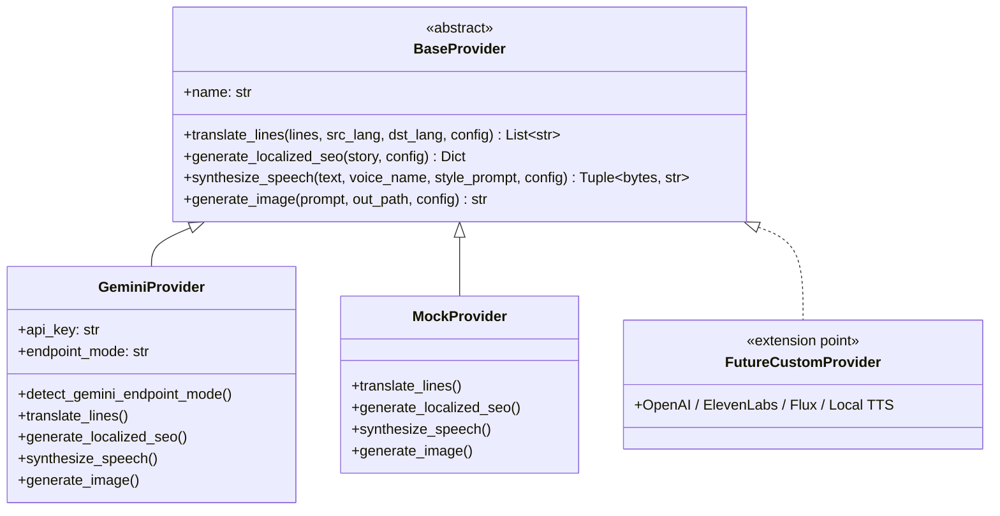

# 🏗️ StoryReel Studio — High-Level Architecture

This document describes the system architecture, data flow, synchronization model, security boundaries, and extension points of **StoryReel Studio** (`storyreel-studio`).

---

## 1. Architectural Principles

1. **Zero Mandatory Runtime Dependencies:** The core Python package (`storyreel/`) uses only the **Python 3.9+ standard library** (`urllib`, `wave`, `json`, `http.server`, `pathlib`, `re`). Video encoding (`16:9` and `9:16`) runs natively inside the user's browser via HTML5 `<canvas>`, **Web Audio API**, and `MediaRecorder` — removing `ffmpeg`, `Node.js`, and heavy media-toolchain setup entirely.
2. **Bring Your Own Key (BYOK) & Provider Abstraction:** AI generation is isolated behind `BaseProvider`. Users bring their own credentials via `.env` (supporting both standard **Google AI Studio** `AIza...` keys and **Vertex AI Express** `AQ....` keys automatically) or run 100% offline using `MockProvider`.
3. **Declarative Story-as-Code:** Every video starts as a single human-readable Markdown file (`stories/<slug>.md`) paired with channel-level configuration (`studio.config.json`). No code edits are needed to change brand identity, characters, art style, voices, or target languages.
4. **Deterministic Caching & Cost Control:** Generated images, per-scene WAVs, translations, and SEO metadata are cached on disk per episode. `--dry-run` computes exact uncached API calls before spending any quota.
5. **Local-First Security Boundary:** Secrets live strictly in `.env` (never embedded in built HTML/JSON), and the preview server binds to `127.0.0.1` with strict path confinement inside `output/`.

---

## 2. System Context & Data Flow

---

## 3. Package & Module Architecture

| Layer | Module | Responsibility |
| :--- | :--- | :--- |
| **CLI Entrypoint** | `storyreel/cli.py` | Parses `init`, `doctor`, `build`, `watch`, and `serve` commands; handles `--dry-run`, `--provider`, and `--skip-*` / `--force-*` flags. |
| **Configuration** | `storyreel/config.py` | Loads `.env` and `studio.config.json`, validates schema, applies defaults, and injects recurring `characters` + `visual_style` into image prompts. |
| **Story Parser** | `storyreel/parser.py` | Parses YAML-style frontmatter, `## Description`, `## Scene N:` blocks, `### Rules` cards, and `### VO` narration lines; detects script source language via Unicode ranges. |
| **AI Providers** | `storyreel/providers/` | `base.py` defines `BaseProvider`; `gemini.py` auto-routes `AIza...` (Google AI Studio) vs `AQ....` (Vertex AI Express); `mock.py` powers zero-cost offline demos & CI tests. |
| **Asset Pipeline** | `storyreel/pipeline/assets.py` | Safely resolves scene/thumbnail assets (blocking path traversal), copies into `output/<slug>/assets/`, and exports missing prompts when images are skipped. |
| **Audio Pipeline** | `storyreel/pipeline/audio.py` | Writes PCM/WAV narration per language/scene, computes exact WAV durations, and stitches silence-padded frame-aligned `audio/full_<lang>.wav` tracks. |
| **Subtitles & SEO** | `storyreel/pipeline/subtitles.py`, `seo.py` | Generates timeline-synced `.srt` cues per language and localized YouTube Titles, synced `0:00` Chapters, Takeaways, Tags, and `seo.md`. |
| **Orchestrator** | `storyreel/pipeline/builder.py` | Implements `plan_build()` (dry-run estimator), coordinates all pipeline stages with disk caching, and renders all HTML templates + `output/index.html`. |
| **Local Server** | `storyreel/server.py` | Serves `output/` strictly on `127.0.0.1`, enforces `is_safe_subpath()`, and exposes `/api/studio` JSON endpoints for the Production Calendar tab. |
| **Frontend Templates** | `templates/*.template.html` | Self-contained, config-driven HTML/CSS/JS apps (`player`, `reel`, `thumbnail`, `dashboard`) with zero build step and zero hardcoded brand strings. |

---

## 4. End-to-End Build Sequence

---

## 5. Multi-Language Frame-Alignment Architecture

When producing multi-language videos (e.g., English + Spanish + Hindi) for **YouTube Multi-Language Audio**, every alternate audio track must share the **exact same scene cut timestamps** as the primary video file.

StoryReel Studio enforces this deterministically in pure Python (`storyreel/pipeline/audio.py`):

1. **Master Scene Slot Calculation:** For each scene $i$ across configured audio languages $L$:
   $$\text{durationSec}_i = \max_{\ell \in L}\left(\text{wavDuration}_{i,\ell}\right) + \text{scene\_padding\_sec}$$
2. **Exact PCM Silence Padding (`stitch_full_wav`):** For every language $\ell$, each scene slot is written at the native sample rate (e.g., `24000 Hz`, 16-bit PCM):
   - Lead silence: `speech_offset_sec` (default `0.15s`)
   - Scene narration audio frames from `audio/<lang>/scene_i.wav`
   - Tail silence: padded so the scene occupies **exact** $\text{round}(\text{durationSec}_i \times \text{sample\_rate})$ frames
3. **Result:** Every `audio/full_<lang>.wav` has the exact same total duration to the millisecond, matching the `16:9` exported video and every `subtitles/<lang>.srt` cue timestamp.

---

## 6. Browser-Native Dual-Format Export Engine (`16:9` & `9:16`)

Instead of requiring server-side `ffmpeg`, both `player.html` (`1280×720`) and `reel.html` (`1080×1920`) render and encode directly in the browser:

- **Visual Pipeline:** An offscreen `<canvas>` composites the animated background (Ken Burns `zoom-in`, `zoom-out`, `pan-lr`, `float`), floating emoji particles, badges, auto-fading top hero banner, animated 3-card takeaway grids, and single-sentence synced captions at **30 FPS**.
  - **16:9 YouTube Mode (`player.html`):** Face-safe framing keeps the middle of the frame clear of overlays.
  - **9:16 Insta Reel / Shorts Mode (`reel.html`):** Defaults to **Cinema Blur Frame** (blurred full-height ambient art + glowing rounded `16:9` center stage so subjects are never awkwardly cropped), with an optional **Full-Bleed Zoom** toggle, **Instagram Safe-Zone Guide** (preview-only, never exported), and an on-demand **Scene Picker** (`Viral Highlights <60s` or custom scene selection).
- **Audio Pipeline:** Web Audio API (`AudioContext`) decodes the selected language's `scene_N.wav` buffers, mixes procedural background music and Web Audio SFX chimes onto a `MediaStreamDestination`, and combines the audio track with `canvas.captureStream(30)`.
- **Encoding:** `MediaRecorder` outputs a ready-to-upload `.mp4` (H.264/AAC where supported) or `.webm` (VP9/Opus) directly to the user's Downloads folder.

---

## 7. Pluggable Provider Interface

Adding a new AI backend requires only subclassing `BaseProvider` in `storyreel/providers/<name>.py` and registering it in `storyreel/providers/__init__.py` — zero changes to the parser, audio stitcher, subtitle builder, or HTML templates.

---

## 8. Security & Cost-Control Boundaries

| Control Area | Enforcement Mechanism |
| :--- | :--- |
| **Credential Isolation** | `.env`, `client_secret.json`, and `token.json` are gitignored; API keys exist only in memory inside `GeminiProvider` and are never serialized to `episode.json` or HTML outputs. |
| **Path Traversal Protection** | `storyreel/pipeline/assets.py` rejects absolute paths and `..` segments; `storyreel/server.py` enforces `is_safe_subpath(output_dir, requested_path)` on every HTTP GET, returning `403 Forbidden` for anything outside `output/`. |
| **Network Exposure** | `storyreel serve` binds strictly to `127.0.0.1` (localhost) by default. |
| **Spend Protection** | `storyreel build --dry-run` computes exact API call counts before execution; disk caching prevents duplicate image/TTS/translation charges across iterative edits. |
| **CI Guardrails** | `.github/workflows/ci.yml` runs unit & security tests on Python 3.9, 3.11, and 3.13, executes an end-to-end mock build, and fails builds if common API key prefixes (`AIza`, `AQ.`, `sk-`) appear in tracked files. |

---

## 9. Future Extension Roadmap

- **Mixed-Provider Routing:** Allow independent provider configuration per modality (e.g., Gemini for text/SEO + Flux for images + ElevenLabs or local Kokoro/Piper for TTS).
- **Theme Packs:** Pluggable CSS/Canvas themes (minimalist documentary, whiteboard explainer, kids storybook, neon tech).
- **Optional Batch CLI Exporter:** Headless Playwright export command for automated CI rendering of MP4 files without opening a browser tab.
